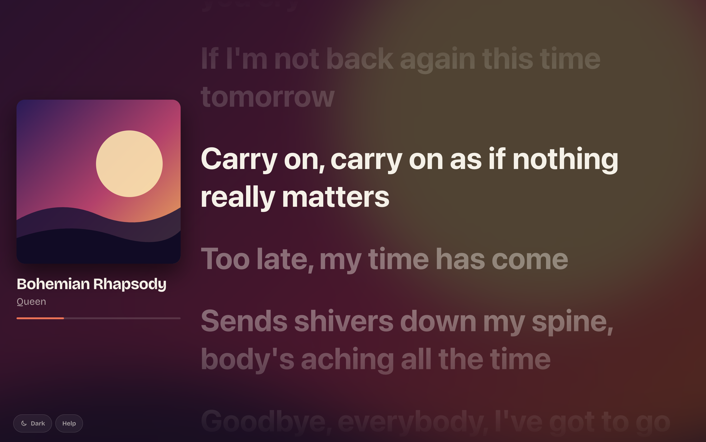

# Lyrical

<p align="center">
  
</p>

Live, time-synced lyrics for whatever is playing on your Spotify account, made
for a big screen you are not typing on: the browser in a Tesla, so passengers
can read along.

- The display shows a QR code. Scan it with your phone, log in to Spotify
  there, and the display switches to the lyrics. Nothing is typed on the display.
- Lyrics come from [LRCLIB](https://lrclib.net); playback position comes from
  the Spotify Web API.

It runs on Cloudflare Workers. To host your own copy, see
[Deploy to Cloudflare](#deploy-to-cloudflare).

## Preview

<p align="center">
  
</p>


## Set up the Spotify app

Every copy of Lyrical needs its own Spotify developer app. It is free to
create.

> [!NOTE]
> A Spotify Premium account is required for the Spotify developer app owner,
> people who only connect to Lyrical can use a free account.

1. Go to the [Spotify developer dashboard](https://developer.spotify.com/dashboard),
   log in and choose **Create app**.

2. Give it any name and description, and select **Web API** as the API it uses.

3. Under **Redirect URIs**, you'll need to add the URL of your deployed Worker,
   as we don't know it yet we'll add it later. For now, we can add the local
   development URL:

   ```bash
   http://127.0.0.1:5173/api/auth/callback
   ```

4. Save the app, open its **Settings** and copy the **Client ID** and
   **Client secret**. These are needed when deploying the Worker.

5. Open **User Management** and add the name and email address of every
   Spotify account that should be able to connect. Your own account does not
   have to be added. While the app is in development mode, Spotify refuses
   accounts that are not on this list.

## Deploy to Cloudflare

Once the Spotify app is set up, you can deploy your own copy of Lyrical to
Cloudflare Workers.

[](https://deploy.workers.cloudflare.com/?url=https://github.com/SanderDelden/lyrical)

1. Use the button above to open the Cloudflare Workers deploy page.

2. Select your Git account or pair with one (GitHub or GitLab) (if not already
   paired). By default it will create the repository `lyrical` under the
   account, change it if you want. Optionally create the repository as private.

3. Fill out `SPOTIFY_CLIENT_ID` and `SPOTIFY_CLIENT_SECRET`, all other fields
   can be left as-is.

4. Click `Deploy`, Cloudflare will now clone the repository into your GitHub or
   GitLab account, creates the KV namespace, and deploy the Worker.

5. Once the deployment is complete, the Worker URL will be displayed in the
   logs. Open your Spotify app's settings in the
   [Spotify developer dashboard](https://developer.spotify.com/dashboard) and
   add this as a redirect URI, with `/api/auth/callback` appended. For example:

   ```bash
   https://<worker-name>.<subdomain>.workers.dev/api/auth/callback
   ```

6. Open `https://<worker-name>.<subdomain>.workers.dev` on the display.

> [!IMPORTANT]
> Also add every Spotify account that will use the app under
> **User Management**. Your own account does not need to be added.

### Changing things later

- **Worker name / URL:** change `name` in `wrangler.jsonc`, and update the
  redirect URI in Spotify to match.
- **Custom domain:** add it to the Worker under **Settings → Domains & Routes**
  in the Cloudflare dashboard, and add
  `https://<your-domain>/api/auth/callback` as a redirect URI in Spotify. The
  app derives its redirect URI from the address it is opened on.
- **Rotating Spotify credentials:** change them under **Workers & Pages → your
  Worker → Settings → Variables and Secrets**.
- **Deploying from your machine instead:** run `npx wrangler login` once, then:

  ```sh
  npm run build
  npx wrangler deploy --secrets-file .dev.vars
  ```

## Development

### Requirements

- Node.js 22 or newer
- A Spotify app (client ID and secret), see
  [Set up the Spotify app](#set-up-the-spotify-app) above.

### Run it locally

1. Install dependencies:

   ```sh
   npm install
   ```

2. Add your Spotify credentials. Copy the example file and fill in both values:

   ```sh
   cp .dev.vars.example .dev.vars
   ```

   ```ini
   SPOTIFY_CLIENT_ID=your-client-id
   SPOTIFY_CLIENT_SECRET=your-client-secret
   ```

3. Start the dev server and open <http://127.0.0.1:5173>:

   ```sh
   npm run dev
   ```

4. Locally the QR code points at `127.0.0.1`, which your phone cannot reach.
   Click the QR code instead to authenticate with Spotify in a new tab. Scanning
   with a real phone needs the deployed version.

> [!TIP]
> To view lyrics screen without Spotify, open <http://127.0.0.1:5173/?demo>. It
> plays a fixed track against the local clock; `?demo=120` starts playing two
> minutes in.

### Tests

```sh
npm test            # run once
npx vitest          # watch mode
```

The tests use [Vitest](https://vitest.dev) and run in plain Node. The Workers
runtime module is replaced by an in-memory stand-in
(`tests/support/cloudflare-workers.ts`) and calls to Spotify and LRCLIB are
mocked. They cover the lyrics lookup and LRC parsing, the Spotify OAuth helpers,
and every API route including the full pairing flow. The screens themselves
(`app/display.tsx` and the pages) are not covered.

## How it works

```bash
display (car)                    worker                         phone
     | POST /api/pair  ---------->| stores pair:CODE in KV
     | shows QR for /pair/CODE    |
     |                            |<------ GET /pair/CODE (confirm the code)
     |                            |<------ /api/auth/login -> Spotify -> /api/auth/callback
     |                            | stores session, attaches it to pair:CODE
     | GET /api/pair/CODE (poll)->| sets the session cookie on the display
     | GET /api/token ----------->| returns a short-lived Spotify access token
     | polls Spotify directly for the current track and position
     | fetches lyrics from LRCLIB directly
```

- The Spotify client secret and refresh tokens stay in the worker. The display
  only ever holds a short-lived access token.
- Only the browser that created a pairing code can collect its session.
- On an iPhone the phone page offers "Continue in the Spotify app", which
  approves the connection in the installed Spotify app instead of the login web
  page. This is experimental: it uses the link Spotify's iOS SDK uses, which
  Spotify does not document for web apps, so it may stop working. The browser
  login stays available as a fallback and is the only option on other devices.
- Between Spotify polls (every 3 seconds) the display extrapolates the playback
  position from its own clock.

| Path | Purpose |
| --- | --- |
| `app/display.tsx` | The display: pairing screen, Spotify polling, lyrics view |
| `app/globals.css` | The whole design: colour tokens for the light and dark theme, and all layout |
| `app/theme-toggle.tsx` | The Auto / Light / Dark button |
| `app/help/` | Help page: what the app does, common questions and the Spotify setup guide |
| `app/pair/[code]/` | Confirmation page opened on the phone |
| `app/api/` | Pairing, Spotify login, token and logout routes |
| `lib/` | Spotify OAuth, KV storage, LRCLIB lookup and LRC parsing |
| `tests/` | Tests for the library code and the API routes |
| `wrangler.jsonc` | Worker config: KV namespace and secrets |
| `.github/workflows/ci.yml` | Lint, test and build on every push |
